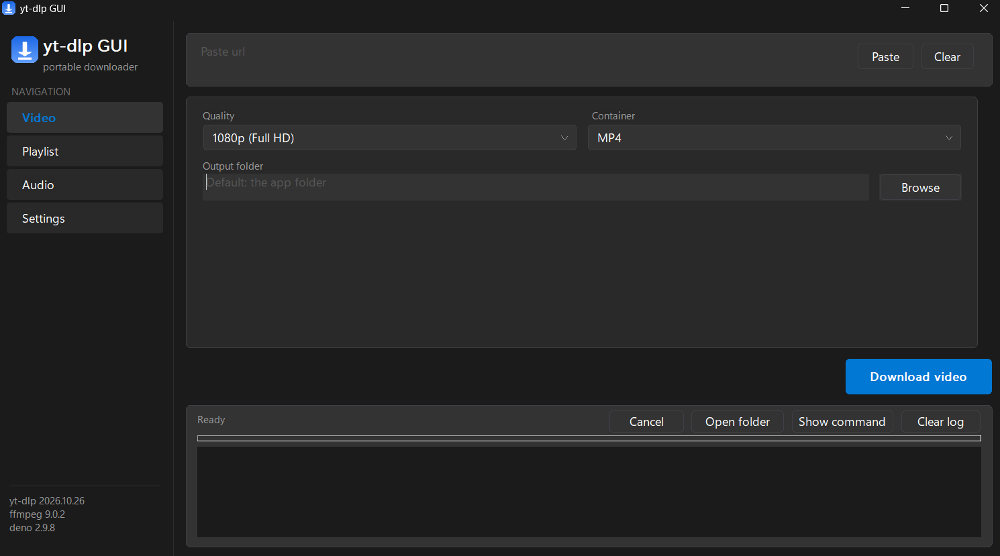
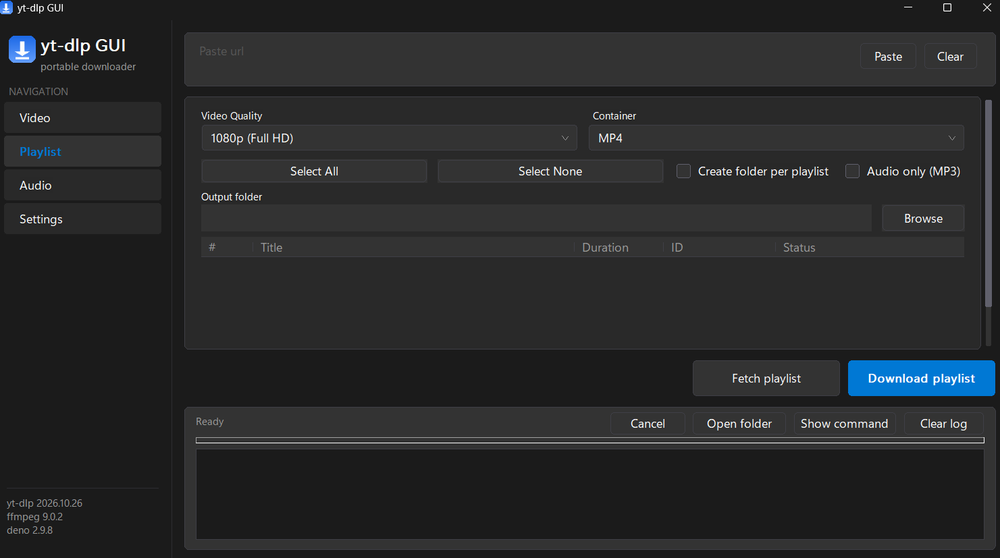
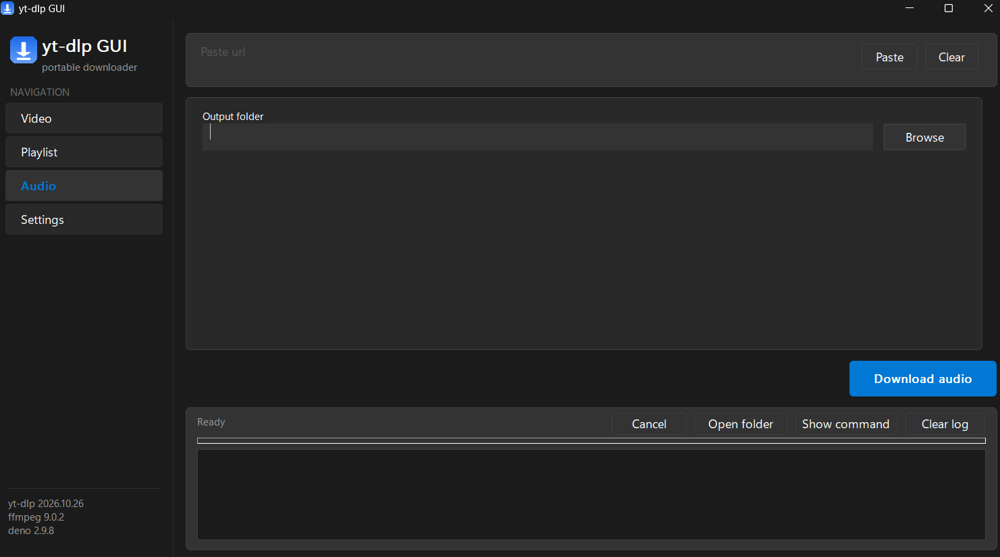
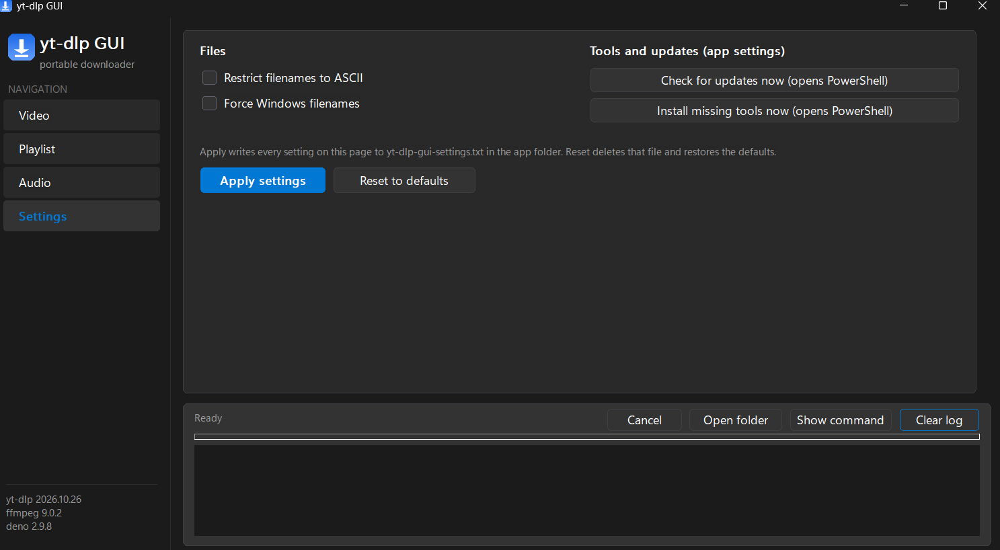

# yt-dlp GUI

> A tiny native Windows front-end for yt-dlp.
>
> Paste a link. Pick a quality. Download. That's the whole idea.

No Electron. No browser engine. No installer. Just one ~945 KB .exe written in C++ — with a healthy amount of vibe coding.

## Why

- **Small.** The whole app is under 1 MB. No bundled Chromium, no runtime folders, no dependencies to ship.
- **Portable.** One executable. Settings are saved next to it.
- **Native.** Plain Win32 and a dark Fluent-style UI, not a website in a trench coat.
- **Quiet.** It never checks for updates behind your back. You update tools only when you ask it to.
- **Useful only when needed.** If a video stops downloading, the manual tool update button is right there in Settings.

## Features

### Video

- Paste a link and fetch the media info.
- Choose quality: Best, 2160p, 1440p, 1080p by default, 720p, 480p, 360p, 240p.
- Choose container: Automatic, MP4 by default, MKV, WebM.
- Pick an output folder or use the default.
- Live progress, status and log output while downloading.
- Cancel a running download at any time.
- Open the output folder with one click.
- “Show command” prints the exact yt-dlp command being used.

### Playlist

- Fetch a playlist and list every entry.
- Tick the videos you want, or use Select All / Select None.
- Download all selected entries in one queue.
- Same quality and container defaults as the Video page.
- Optional Create folder per playlist.
- Audio only (MP3) mode: every selected entry is saved as an MP3 instead of a video.

Clicking Audio only opens a small dark options popup:

- One combined toggle: Embed thumbnail and metadata — both on or both off.
- OK confirms and closes, even if you didn’t change anything.
- Esc closes without changing the setting.
- Defaults stay sensible: 1080p, MP4, embedding on.

### Audio

- MP3 only, no format or bitrate clutter.
- Thumbnail and metadata are always embedded — no extra toggles.
- Choose an output folder and download.

### Settings

- Restrict filenames to ASCII
- Force Windows filenames
- Check for updates now (opens PowerShell) — manual winget check for yt-dlp, ffmpeg and Deno.
- Install missing tools now (opens PowerShell) — runs winget with a Windows admin prompt.
- Apply and Reset buttons.

### Tools

- Detects yt-dlp, ffmpeg and Deno automatically.
- Shows detected versions in the sidebar.
- Offers to install anything missing through winget.
- PowerShell windows close when you press Enter.
- After installing tools, the app closes and reopens so the new versions are picked up.
- After installing updates, it restarts only when updates were actually installed.

### App

- Dark native UI with rounded corners and DPI scaling.
- Remembers window position and size.
- Ctrl+Q closes the app from anywhere.
- Clear log button.
- Status bar, progress bar and cancellable jobs.
- Everything local. No telemetry, no account, no background service.

## Screenshots

### Video page



### Playlist page



### Audio page



### Settings page



## Requirements

### To run

- Windows 10 or 11 (64-bit)
- yt-dlp, ffmpeg and Deno
- Internet connection
- Optional: Microsoft App Installer / winget, only if you want the app’s automatic tool installation

The app can install yt-dlp, ffmpeg and Deno for you through winget. If you prefer, install them yourself and the app will detect them.

Deno is used by modern yt-dlp versions as its JavaScript runtime for certain extractors.

## Build

Windows only.

### Requirements

MinGW-w64 GCC with both of these on your PATH:

- `g++`
- `windres`

That’s it.

No Visual Studio, no Windows SDK, no CMake, no vcpkg, no third-party libraries.

### Good ways to get the toolchain

- MSYS2 with the mingw-w64-x86_64-gcc package
- WinLibs standalone MinGW-w64

### Build

```cmd
cmd /c build.bat
```

The script compiles `res\app.rc` with windres, then compiles and links all sources with static GCC/C++ runtimes.

**Output:**

```text
build\yt-dlp-gui.exe
```

The resulting executable is standalone. No DLLs to copy.


## Quick start

1. Run `yt-dlp-gui.exe`.
2. If tools are missing, click Install required tools and approve the Windows admin prompt.
3. Paste a video link.
4. Pick quality and container.
5. Hit Download video.

**For playlists:**

1. Go to Playlist.
2. Paste the playlist link.
3. Hit Fetch playlist.
4. Tick the entries you want.
5. Hit Download playlist.

**For MP3s:**

1. Go to Audio.
2. Paste the link.
3. Hit Download audio.

## If downloads stop working

Video sites change. yt-dlp changes with them.

Try this, in order:

1. Open Settings.
2. Click Check for updates now (opens PowerShell).
3. Approve the admin prompt.
4. Let winget update yt-dlp, ffmpeg and Deno.
5. Press Enter to close PowerShell.

The app restarts after updates are installed.

If it still fails, use Show command and run the same command in a terminal to see the full yt-dlp error. Some sites require cookies, sign-in, or other yt-dlp options this GUI does not expose.


## Credits

- yt-dlp — the actual downloader doing the hard work
- FFmpeg — merging and audio conversion
- Deno — JavaScript runtime used by yt-dlp
- winget — tool installation and updates

Not affiliated with YouTube, yt-dlp, FFmpeg or Deno.
